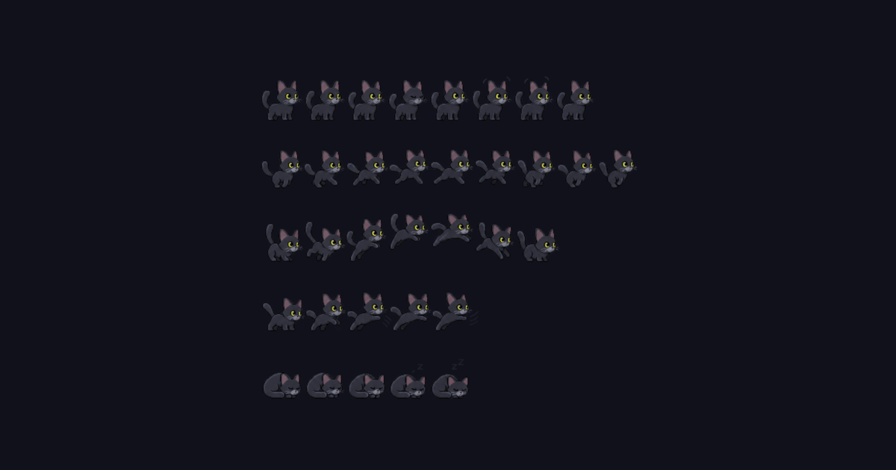

# omarchy-cat-cursor

I gave my agent several photos of my cat and it made me a cursor just like him. It makes me so happy and I want to share it with the world.



**Super + Alt + C** toggles it on and off. **Left click** plays an attack animation (non-consuming bind).

## Install (Omarchy)

```bash
omarchy plugin add https://github.com/AlbertMerle/omarchy-cat-cursor.git --enable --yes
~/.config/omarchy/plugins/io.github.AlbertMerle.cat-cursor/install.sh
```

`omarchy plugin add` installs and enables the shell plugin; `install.sh` creates the user systemd unit, Hyprland keybinds, and layer rules.

## Install (manual)

```bash
git clone https://github.com/AlbertMerle/omarchy-cat-cursor.git
cd omarchy-cat-cursor
./install.sh
```

Requires Hyprland, Quickshell, and Python 3 (standard on Omarchy).

## Uninstall

From the plugin directory (or your git checkout):

```bash
./uninstall.sh
```

## For plugin authors

Validate before publishing to the [Omarchy plugin marketplace](https://plugins.omarchy.org/publish.html):

```bash
omarchy plugin validate .
```

## License

MIT — see [LICENSE](LICENSE).
